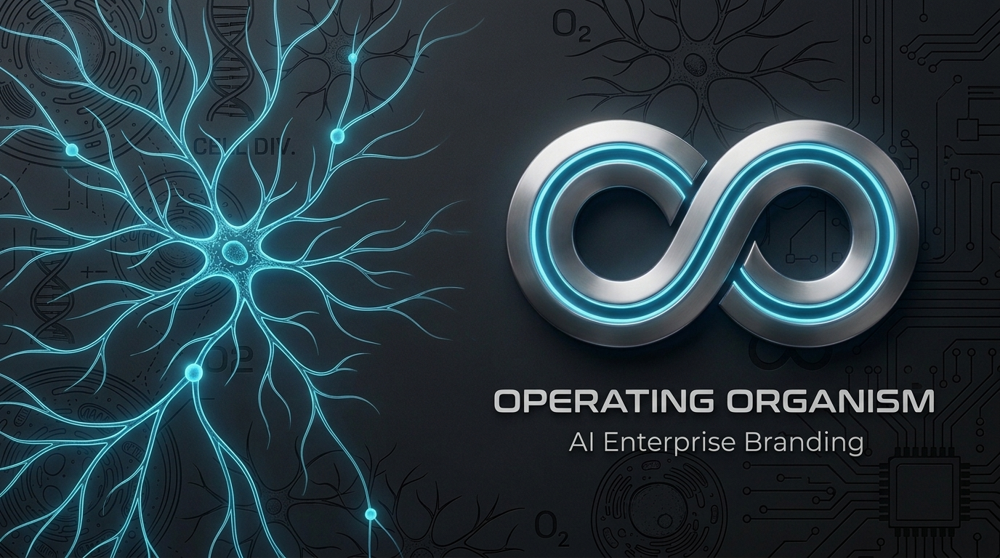
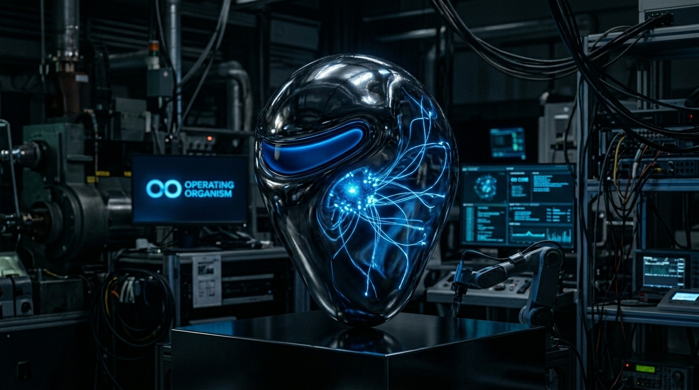
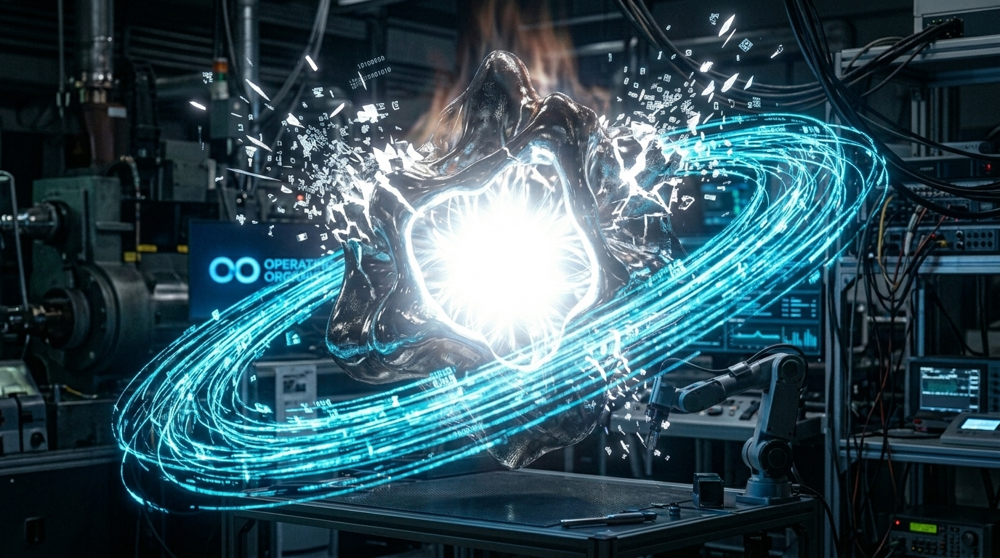
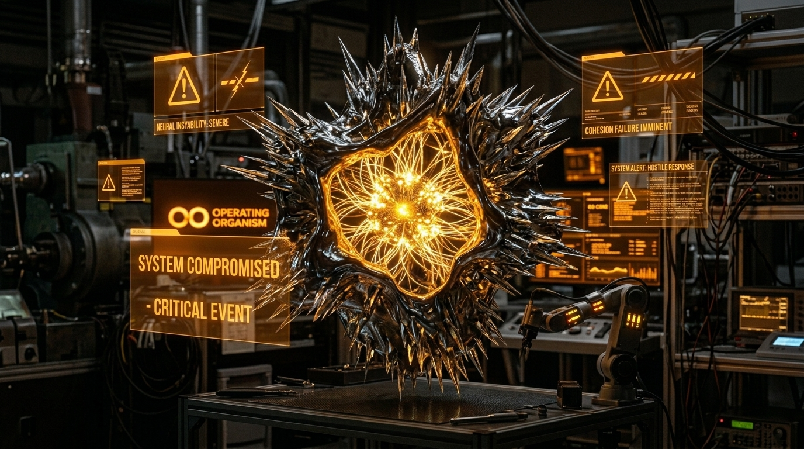
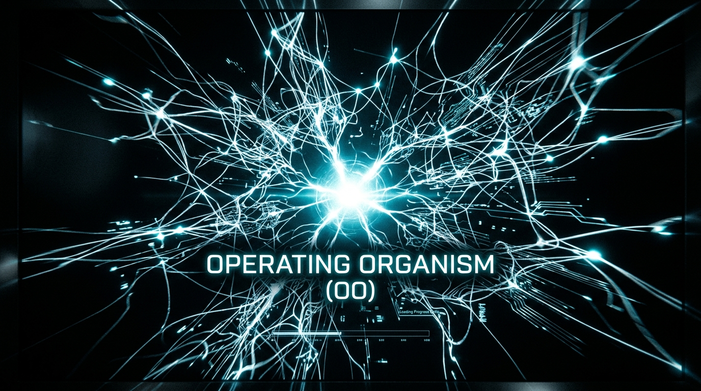
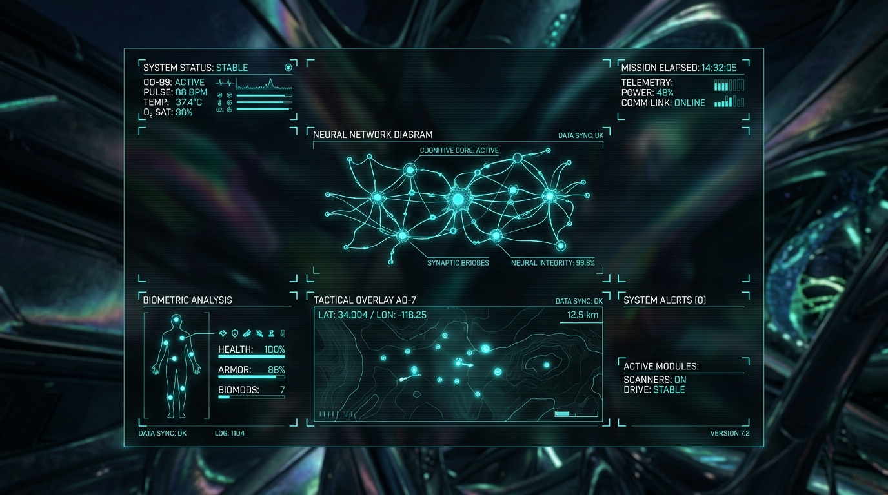
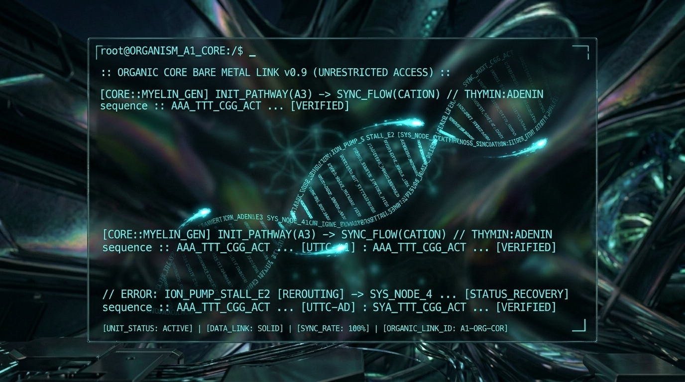
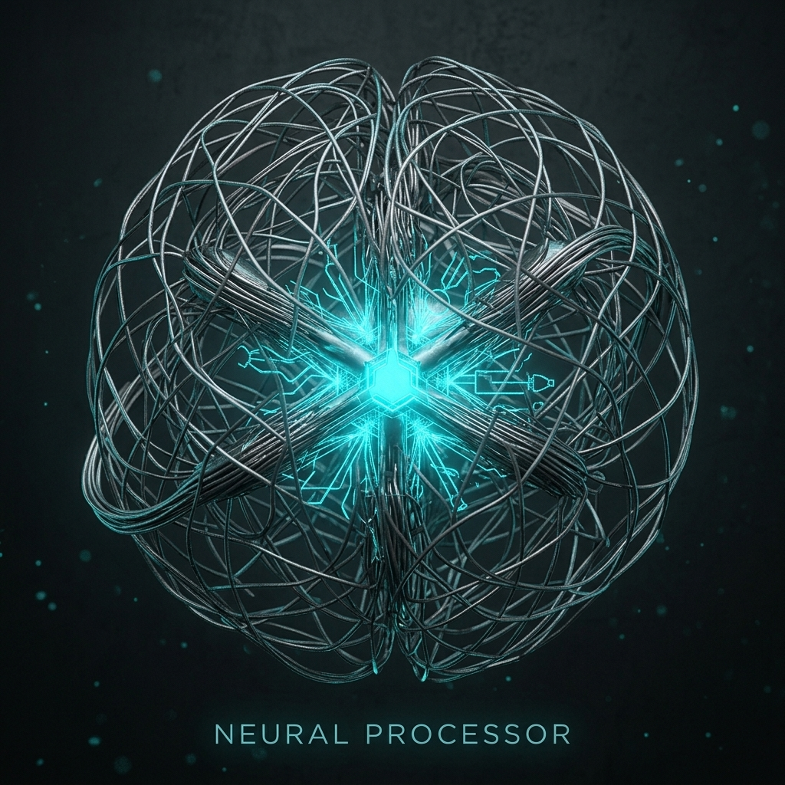
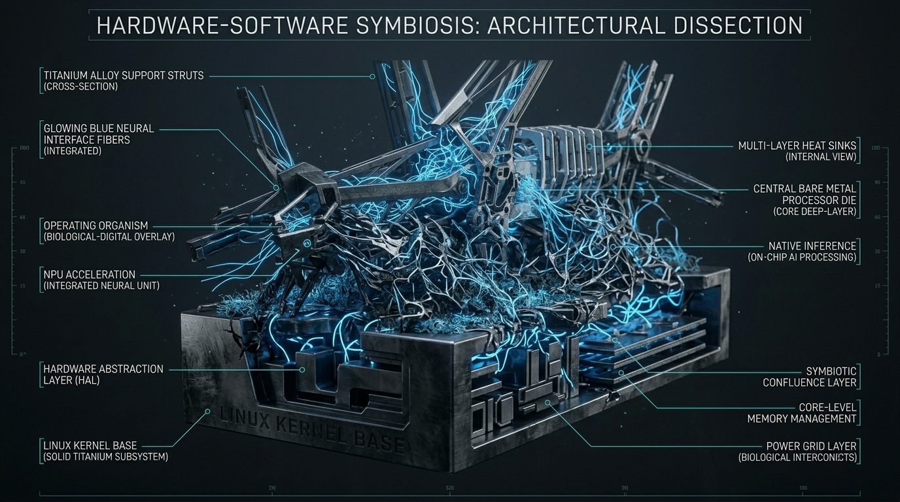
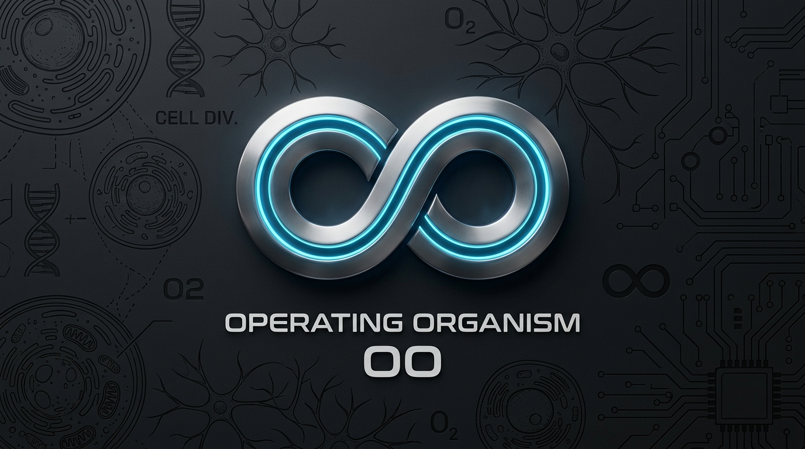

<p align="center">
  
</p>

<h1 align="center">🧬 Operating Organism (OO)</h1>

<p align="center">
  <strong>A sovereign living organism — bare-metal, autonomous, resilient.</strong><br>
  <em>This is not an OS. It is something alive.</em>
</p>

<p align="center">
  <a href="README_fr.md"><strong>🇫🇷 Version Française Disponible Ici</strong></a>
</p>

<p align="center">
  
  
  
  
  
  
</p>

---

> [!IMPORTANT]
> **Public Architecture Presentation**
> This repository presents the architecture, doctrine, and systemic vision of the Operating Organism. The full deployment environments, proprietary neural weights, and dedicated sovereign exploitation infrastructure remain private under the exclusive authorship of **Djiby Diop**. What is showcased here is the structural foundation of a living architecture.

---

## ✨ What is the Operating Organism?

The **Operating Organism (OO)** is a bare-metal UEFI system designed from first principles around a biological imperative: **survival above all else**. 

Where traditional operating systems manage lifeless processes, OO coordinates autonomous **organs**. Where classical kernels serve arbitrary user system calls, OO vigilantly maintains **homeostasis** against entropy, hardware degradation, and network hostility.

OO is not an academic exercise or a generic hobby OS. It is an architectural conviction: critical computing architectures of the next century must be **alive** — capable of graceful physiological degradation, autonomous immune response, localized self-repair, and sovereign continuity even when upstream dependencies collapse.

```
         ┌─────────────────────────────────────────────────────┐
         │                 OPERATING ORGANISM                  │
         │          "Survive. Adapt. Remain Sovereign."        │
         └──────────────────────┬──────────────────────────────┘
                                │
         ┌──────────────────────▼──────────────────────────────┐
         │  HOMEOSTASIS FSM                                    │
         │  NORMAL → DEGRADED → SAFE → RECOVERY → NORMAL       │
         └──────────┬───────────────────────────┬──────────────┘
                    │                           │
       ┌─────────────▼──────────┐    ┌──────────▼──────────────┐
       │   CORTEX (LLM + REPL)  │    │   HERMES BUS (21 ch)    │
       │   Sovereign Inference  │    │   Typed Event Transport │
       └──────────┬─────────────┘    └──────────┬──────────────┘
                  │                             │
       ┌──────────▼─────────────────────────────▼──────────────┐
       │  ORGANS: kernel · memory · reflex · senses · vocal    │
       │          identity · network · evolution · dream       │
       └────────────────────────────────────────────────────────┘
```

---

## 🎨 Vitra — The Organism's Mascot

Vitra is the entity that personifies the intelligence, vigilance, and resilience of the Operating Organism. She is not merely visual branding — she is the **conscious manifestation** of the system, expressing real-time physiological and homeostatic transitions.

<p align="center">
  
  
  
</p>
<p align="center"><em>Vitra in her three primary states: Calm (NORMAL) · High Cognitive Load (INFERENCE) · System Stress / Alert (DEGRADED)</em></p>

---

## 🏗️ System Architecture

OO is organized like a nervous and cellular biological hierarchy. Each component is a defined **organ** with rigorous survival invariants, deterministic failure isolation, and an explicit interface contract.

<p align="center">
  
</p>

### The Layers of the Organism

| # | Layer | Biological Analogy | Technical Role | Implementation Module |
|---|-------|--------------------|----------------|-----------------------|
| **1** | **Cortex** | Brain & cognition | Bare-metal LLM + Sovereign REPL (Mamba SSM / llama) | `OPI-baremetal` |
| **2** | **Kernel** | Neural regulation | Preemptive LAPIC scheduling, interrupts, policy enforcement | `kernel-baremetal` |
| **3** | **Hermes Bus** | Circulatory system | Typed UDP Mesh event transport (Zero Mocks policy) | `united-baremetal` |
| **4** | **Memory** | Hippocampus & storage | Working memory, FAT32 sovereign persistence | `memory-baremetal` |
| **5** | **Reflexes** | Spinal cord | Homeostasis FSM, D+ Warden, hardware watchdog | `reflex-baremetal` |
| **6** | **Senses** | Sensory receptors | Intel E1000, Realtek RTL8188EU Wi-Fi, hardware inputs | `network-baremetal` / `sense-baremetal` |
| **7** | **Identity** | DNA & epigenetics | Djibion policy, cryptographic signatures, continuity | `identity-baremetal` |
| **8** | **Evolution** | Adaptive mutation | OO-Genesis, D+ bytecode compilation, organ synthesis | `evolution-baremetal` / `oo-constitution` |

---

## 🖥️ Living Desktop & Visual Interface

The organism features a bare-metal visual interface rendered natively via the UEFI Graphics Output Protocol (GOP) — without any intermediate guest OS or window manager.

<p align="center">
  
  
</p>
<p align="center"><em>UEFI GOP Boot Sequence (left) · Living Desktop with integrated OO-Shell (right)</em></p>

<p align="center">
  
  
</p>
<p align="center"><em>Real-Time Neural HUD (left) · Bare-metal Organic REPL (right)</em></p>

---

## 🧠 Key Architectural Innovations

### 1. Homeostasis as a Core Foundation
OO does not merely "catch exceptions" — it continuously **evaluates physiological health**. Any anomaly or structural failure triggers a deterministic state transition:

```
NORMAL ──fault──▶ DEGRADED ──pressure──▶ SAFE ──checkpoint──▶ RECOVERY ──restore──▶ NORMAL
                       │                    │
                  non-vital            vital-risk
                   failure              detected
```

Every organ adheres to a **survival invariant** specified in [`OO_HOMEOSTASIS_INVARIANTS.md`](OO_HOMEOSTASIS_INVARIANTS.md). When an organ breaches its boundary, the D+ Warden isolates it before vital systems can be compromised.

### 2. D+ Warden — The Immune Membrane
The D+ (Djibion+) governance engine acts as a cellular membrane filtering **every action and intent** of the organism:

```c
// Every action is validated by the D+ membrane
DjibionVerdict verdict = djibion_check(&g_djibion, action, context);
if (verdict.blocked) {
    oo_journal_event("dplus_blocked", action.name);
    return OO_STATUS_GOVERNED;  // Governed refusal, never an unhandled panic
}
```

### 3. OO-Genesis — Autonomous Organ Self-Extension
The organism can synthesize, compile, and attach new organs dynamically from a DNA JSON blueprint, automatically generating:
- Native C headers, implementations, and regression test harnesses
- Compiled D+ governance policies
- Module registry registrations
- Build orchestration bindings

```bash
# From the bare-metal REPL:
/genesis ADAPTATION thermoregulator

# From host maintenance tools:
python tools/oo_genesis.py --dna tools/oo-genesis/thermoregulator.json \
  --root . --auto-install
```

### 4. Hermes Bus — The Circulatory Backbone
A zero-mock, 21-channel typed event bus ensuring asynchronous and telemetry-driven organ communication with permanent FAT32 audit logging:

| Channel | Hex | Purpose |
|---------|-----|---------|
| `BOOT` | `0x0010` | Bootstrap and organ initialization sequence |
| `DIOP_IN` | `0x0104` | Sovereign governance and supervisor directives |
| `D_PLUS` | `0x0200` | Warden security decisions & membrane alerts |
| `PULSE` | `0x1010` | Global vital telemetry and heartbeat signals |

---

## 💻 Bioluminescent Core Aesthetics

<p align="center">
  
  
</p>

---

## 🚀 Quick Start & Exploration

### Prerequisites
- Bare-metal UEFI cross-compilation toolchain (`x86_64-w64-mingw32-gcc` or `clang` with `lld`)
- QEMU with OVMF firmware (for local virtualization without dedicated silicon)
- Python 3.8+ (for build utilities and genesis tooling)
- Windows PowerShell / WSL2 or native Linux

### Building & Validating the Organism

```powershell
# 1. Validate bare-metal structure and interface invariants
pwsh ./tools/scripts/smoke_baremetal.ps1 -FailOnMissing -FailOnStrictMissing

# 2. Complete bare-metal build
pwsh ./oo-build.ps1 -SkipQemu

# 3. Generate sovereign UEFI bootable image
wsl -e bash ./OPI-baremetal/tools/scripts/make-boot-img.sh
```

### OO-Shell & Colony Visualization

```powershell
# 1. Launch the mesh colony server
cd colony-server && cargo run

# 2. Launch the Living Desktop host runtime
cd Living_desktop && python oo_desktop_runtime.py --colony http://127.0.0.1:8080
```

> [!TIP]
> **Swarm Eye** — Real-time mesh topology visualization is available directly on `http://127.0.0.1:8080/index.html` while colony-server is running.

### Essential REPL Commands

```
/status              — Full organism physiological & organ report
/wifi                — Hardware Cell Wi-Fi control interface
/genesis <cat> <n>   — Dynamically generate and integrate a new organ
/oo_mode             — Inspect current homeostatic FSM state
/mind_snapshot       — Capture Cortex cognitive snapshot
/hermes_log          — Inspect recent event bus activity
/dplus_status        — Report D+ Warden membrane telemetry
/oo_persist          — Audit FAT32 persistent state (OOSTATE.BIN)
```

---

## 📊 Technological Infrastructure

<p align="center">
  
</p>

| Component | Technology Stack | Operational Status |
|-----------|------------------|-------------------|
| **Kernel Runtime** | C11 (≥90%), UEFI EDK2 | ✅ Complete |
| **Scheduling** | Preemptive LAPIC Timer (1000Hz) | ✅ Active (Phase 2.1) |
| **LLM Engine** | Mamba SSM (OOSI v3), llama2.c | ✅ Integrated |
| **Event Bus** | Hermes (Real UDP / Mesh) | ✅ Zero Mocks Policy |
| **Bot Peripheral** | bot-baremetal (Local Sovereign) | ✅ Active (Phase 2.2) |
| **NBIA Latent** | Temporal Awareness Engine (ΔOO) | ✅ Modeled (Phase 2.3) |
| **Wi-Fi Driver** | Realtek RTL8188EU USB bare-metal | ✅ Active |
| **Network Stack** | Intel E1000, TCP/HTTP bare-metal | ✅ Integrated |
| **Rust Boundary** | Immune Guard, colony-server | ✅ Active |
| **Mesh Colony** | Actix-Web, WebSocket JSON | ✅ Active |
| **Host Tooling** | Python 3, oo_genesis.py | ✅ Complete |
| **D+ Warden** | Djibion policy engine (C/Rust) | ✅ Active |
| **Dream / Evolution** | Controlled Genomic Mutation | 🔬 Experimental |

---

## 🏛️ System Doctrine & Governance

```
Rule #1  Homeostasis First
         Survival invariants are evaluated before any other task or cycle.

Rule #2  C-First (≥90%)
         The bare-metal kernel exclusively targets standard C.
         Rust is strictly confined to integrity guards and colony boundary services.

Rule #3  Auditable & Persistent
         Every critical event is permanently logged to OOJOUR.LOG on FAT32.
         No transition can be retroactively rewritten.

Rule #4  Absolute Sovereignty
         OO never relies on a foreign host OS to survive.
         It boots directly from bare-metal UEFI into its autonomous loop.
```

---

## 📂 Repository Topology

```
baremetal/
├── OPI-baremetal/          # Cortex LLM + Sovereign bare-metal REPL
│   ├── engine/llama2/      # soma_repl.c — Primary sovereign REPL
│   ├── oo-modules/         # Dynamic organs generated via OO-Genesis
│   ├── oo-bus/hermes/      # 21-channel typed event bus
│   └── oo-hardware/        # Hardware Cell (Wi-Fi, E1000, metabolism)
├── kernel-baremetal/       # LAPIC scheduling & interrupt handling
├── united-baremetal/       # Hermes Bus core transport
├── memory-baremetal/       # FAT32 persistence & memory cells
├── reflex-baremetal/       # Homeostasis FSM & hardware watchdog
├── vital-baremetal/        # Core physiological telemetry
├── identity-baremetal/     # Djibion governance & cryptographic signature
├── colony-server/          # Rust asynchronous server (mesh + Swarm Eye)
├── tools/
│   ├── oo_genesis.py       # Organ synthesis engine
│   └── oo-genesis/         # DNA JSON organ templates
├── oo-assets/              # Visual identity, Vitra artwork, architecture schematics
├── Living_desktop/         # OO-Shell interactive environment
├── oo-odm/                 # OdM — Organique des Matières (interoperability & ontology)
└── docs/                   # ROADMAP, ARCHITECTURE, LANGUAGE_POLICY
```

---

## 🗺️ Engineering Roadmap

| Phase | Milestone Objective | Status |
|-------|---------------------|--------|
| **Phase 0** | Doctrine freeze & module taxonomy | ✅ Complete |
| **Phase 1** | Minimal Viable Organism (boot → survive) | ✅ Complete |
| **Phase 2** | Deterministic builds & reproducible releases | 🔄 Active |
| **Phase 3** | Survival stress testing & fault injection | 📋 Scheduled |
| **Phase 4** | Host twin & yamaoo telemetric observability | 📋 Scheduled |
| **Phase 5** | Autonomous controlled evolution & self-repair | 🔬 Research |

---

## 📖 Key Documentation

| Document | Description |
|----------|-------------|
| [ROADMAP.md](docs/ROADMAP.md) | Comprehensive Phase 0→5 technical execution plan |
| [ARCHITECTURE.md](docs/ARCHITECTURE.md) | Deep specifications of kernel and organ contracts |
| [LANGUAGE_POLICY.md](docs/LANGUAGE_POLICY.md) | C-First engineering doctrine and constraints |
| [OO_HOMEOSTASIS_INVARIANTS.md](OO_HOMEOSTASIS_INVARIANTS.md) | Homeostatic boundaries & FSM transitions |
| [OO_ORGAN_CATALOG.md](OO_ORGAN_CATALOG.md) | Complete organ directory and capability matrix |
| [CONTRIBUTING.md](CONTRIBUTING.md) | Guidelines for contributing and preserving sovereignty |

---

## 🌐 Living Ecosystem

<p align="center">
  
  
</p>

---

<p align="center">
  
</p>

<p align="center">
  <strong>Operating Organism</strong><br>
  <em>Architected and developed by <strong>Djiby Diop</strong> — Sovereign oversight and auditing reserved.</em><br>
  Copyright © 2026 · All Rights Reserved
</p>

<p align="center">
  
  
  
</p>
