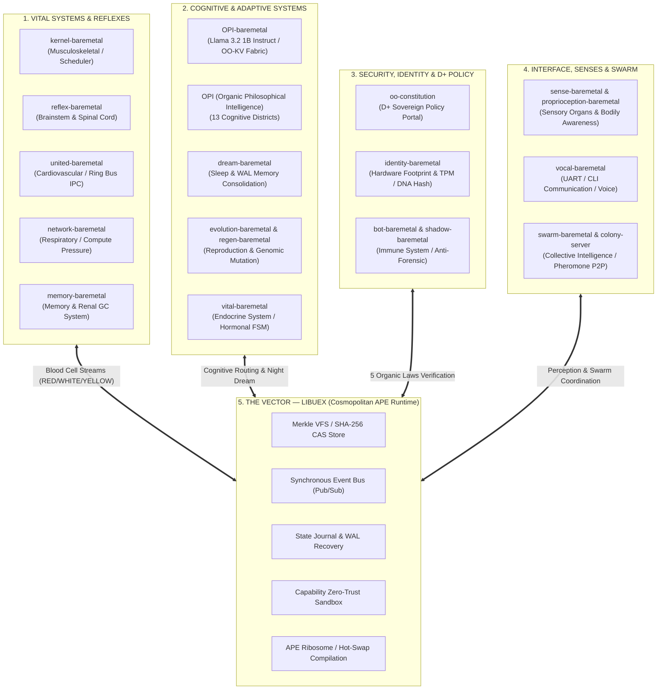

# THE SOVEREIGN ORGANISM (OO) — COMPREHENSIVE SPECIFICATION OF PILLARS v2.0
**Computational Biological Architecture: `OO` × `OPI` × `LIBUEX` × `THE 22 ORGAN SYSTEMS`**

---

## 1. Holistic Vision: A Living Software Organism

The Baremetal ecosystem is not merely a computational trinity; it constitutes a **complete Living Software Organism**, structured around **22 physiological and computational systems**. Each module embodies a specialized organ working in continuous homeostasis under the control of the sovereign **D+** policy and executing via the universal portable runtime **`libuex`**.

---

## 2. Comprehensive Mapping of Organism Pillars

| Pillar / Module | Biological System | Computational & Physiological Role | Status & Validation |
| :--- | :--- | :--- | :--- |
| **`kernel-baremetal`** | **Musculoskeletal System** | Autonomous bare-metal scheduler, CPU management without host OS. | UEFI Validated |
| **`reflex-baremetal`** | **Brainstem & Spinal Cord** | Ultra-low latency reflex loop and survival safety fallback (`SafeModeEngine`). | Validated |
| **`united-baremetal`** | **Cardiovascular System & Blood** | Ring IPC bus and blood cell transport (`RED`=data, `WHITE`=immunity, `YELLOW`=energy). | Validated |
| **`network-baremetal`** | **Respiratory System** | Compute pressure regulation and network breathing (`ThroughputBreathingEngine`). | Validated |
| **`memory-baremetal`** | **Core Memory & Renal System** | Memory manager `bio_alloc`, garbage collection (GC), and waste pruning. | Validated |
| **`OPI-baremetal`** | **Cerebral Cortex** | Native bare-metal inference engine (**Llama 3.2 1B Instruct** with GQA/RoPE & OO-KV Fabric). | Validated (13/13 + Phase W) |
| **`OPI`** | **Cognitive & Philosophical Brain** | 13 cognitive districts, intention routing, *Cognitive Virtual Machine* (`CVM`). | Validated (21/21 tests) |
| **`dream-baremetal`** | **Sleep & Recovery System** | Background memory consolidation (Idle-Time Learning), WAL compaction. | Validated |
| **`evolution-baremetal`** | **Reproductive & Genomic System** | Regulated self-evolution, `SomaDNA` genomic mutation governed by D+ rules. | Validated |
| **`vital-baremetal`** | **Endocrine System** | Mode signaling via hormonal indicators, adaptive load thresholds. | Validated |
| **`oo-constitution`** | **Hepatic & Ethical Filtering** | **D+** sovereign gate enforcing the 5 Organic Laws on all compute requests. | Validated |
| **`identity-baremetal`** | **DNA & Self-Recognition** | Cryptographic fingerprinting (FNV-1a / SHA-256) of genome (`OO_DNA.bin`) and TPM. | Validated |
| **`bot-baremetal` & `shadow-baremetal`** | **Immune System & Skin** | Anomaly detection, autonomous quarantine, anti-forensic defense. | Validated |
| **`sense-baremetal` & `proprioception-baremetal`** | **Sensory Organs & Proprioception** | Multi-modal sensory ingestion, stack/heap posture and integrity monitoring. | Validated |
| **`vocal-baremetal`** | **Vocal & Language System** | Human-machine interface (UART, CLI, synthesis, and dialog output). | Validated |
| **`swarm-baremetal` & `colony-server`** | **Lymphatic & Swarm System** | Multi-instance coordination via P2P pheromones and backpressure balancing. | Validated |
| **`libuex`** | **Universal APE Vector** | Cosmopolitan Libc portable runtime freeing execution across any host or bare-metal. | Validated (6/6 Pillars) |

---

## 3. Blood Cell Exchange Dynamics on the EventBus (`libuex`)

All 22 organs communicate through a continuous, synchronous event stream across the `libuex` EventBus, mirroring biological blood circulation:
- **Red Blood Cells (`topic: "oo.globule.red"`)**: Carry payload (inference tokens, semantic queries, sensory inputs).
- **White Blood Cells (`topic: "oo.globule.white"`)**: Carry immune signals, `bot-baremetal` quarantine alerts, and D+ locks.
- **Yellow Blood Cells (`topic: "oo.globule.yellow"`)**: Carry computational energy, token budgets, and endocrine regulation (`vital-baremetal`).

---

## 4. Execution & Orchestration Demonstrator (`test_trinite_bridge.c`)

The validation suite in `libuex` validates the coordinated execution of these multiple pillars across the universal `libuex` event bus, ensuring strict compliance with zero-mock, hardware-grounded execution doctrine.
