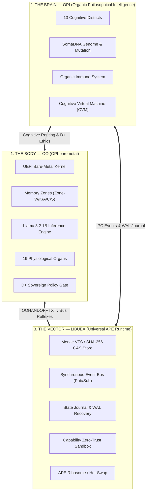
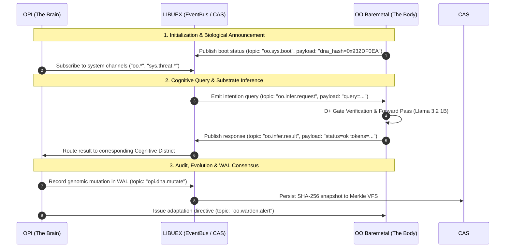

# THE SOVEREIGN TRINITY — ARCHITECTURAL SPECIFICATION v1.0
**Autonomous Organic Ecosystem: `OO` × `OPI` × `LIBUEX`**

---

## 1. Vision & Philosophical Foundations

The sovereign architecture is built upon an **indissociable trinity** where each pillar fulfills a distinct biological and computational role in a complete software organism:

---

## 2. Role of the Three Pillars

### A. `OO` / `OPI-baremetal` (The Body — Bare-Metal Execution & Neural Substrate)
- **Primary Role**: Autonomous operating system and native inference engine executing without a conventional host OS (direct UEFI boot).
- **Neural Engine**: Native **Llama 3.2 1B Instruct** inference with Grouped-Query Attention (GQA), Rotary Positional Embeddings (RoPE), and the **OO-KV Fabric** for sovereign context persistence.
- **Physiology**: 19 coordinated physiological organs (Djibion, Evolvion, Conscience, Immunion, Thanatosion, etc.) with continuous ethical filtering via the **D+** portal.
- **Identity Continuity**: Cross-reboot memory persistence via `OO_DNA.bin` (cognitive identity) and `OOHANDOFF.TXT` (sovereign physiological state).

### B. `OPI` (The Brain — Organic Philosophical Intelligence)
- **Primary Role**: Cognitive supervisor, semantic planner, and philosophical guardian.
- **Topology**: 13 specialized districts (Concept, Intent, Language, Planning, Shield, Verification, Math, etc.) interconnected via an internal semantic bus.
- **Resilience**: Capable of simulating speculative scenarios (*Cognitive Virtual Machine*), detecting behavioral anomalies, and triggering autonomous immune responses.

### C. `libuex` (The Vector — Evolutionary Universal Runtime in APE)
- **Primary Role**: Autonomous portable runtime built on Cosmopolitan Libc (`cosmocc`), able to execute across any host OS or bare-metal environment as an *Actually Portable Executable* (APE).
- **The 6 Pillars**:
  1. **SHA-256 CAS**: Content-Addressable Storage (Merkle VFS / embedded Git).
  2. **Event Bus**: Synchronous Pub/Sub communication with wildcard topic matching (`*`, `?`).
  3. **State Journal WAL**: Write-Ahead Logging with zero-loss crash recovery.
  4. **Capability Zero-Trust**: Granular per-plugin sandboxing (`pledge()` / `unveil()`).
  5. **Task Scheduler**: Self-healing asynchronous scheduler for concurrent tasks.
  6. **APE Ribosome**: Dynamic synthesis and hot-swapping of modules at runtime.

---

## 3. Interface Contract & Tripartite Symbiosis Protocol

Interaction among the 3 pillars proceeds across a standardized **3-layer communication protocol**:

---

## 4. Maturity Matrix & Validation Status

| Component | Test Status | Validated Samples / Pillars | Next Technical Milestone |
| :--- | :---: | :---: | :--- |
| **`libuex`** | **100% Validated** | **6 / 6 Pillars** (`test_uex.exe`) | Integration of shared IPC bridge (`shm_open`) for multi-binary coordination. |
| **`OPI`** | **100% Validated** | **21 / 21 Tests** + Symbiosis | Linking OPI's Semantic Bus to `libuex` Event Bus. |
| **`OO` / `OPI-baremetal`** | **100% Validated** | **Llama 3.2 Substrate** + **Phase W** (61 concepts) | Physical ThinkPad T480 deployment and autonomous HTTPS Sovereign Browser. |

---

## 5. Operational Roadmap

1. **Phase 1: Tripartite Bridge (`trinite_runtime_bridge.c`)**
   - Unified connector allowing a `libuex` instance to encapsulate and drive both user-space `OPI` and bare-metal `OO`.
2. **Phase 2: Self-Evolution & Merkle VFS (CAS + Evolvion)**
   - Connect `evolvion` (autonomous code generation) and `immunion` to `libuex` SHA-256 CAS to cryptographically log every kernel mutation.
3. **Phase 3: Silicon Flight & Physical Hardware Proof**
   - Direct execution on target physical hardware (Lenovo ThinkPad T480) with full inter-session persistence via `OOHANDOFF.TXT` and `OO_DNA.bin`.
